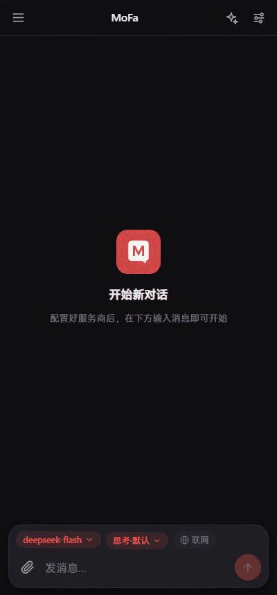
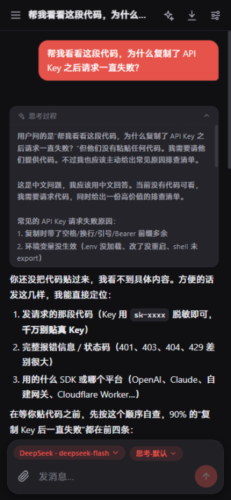
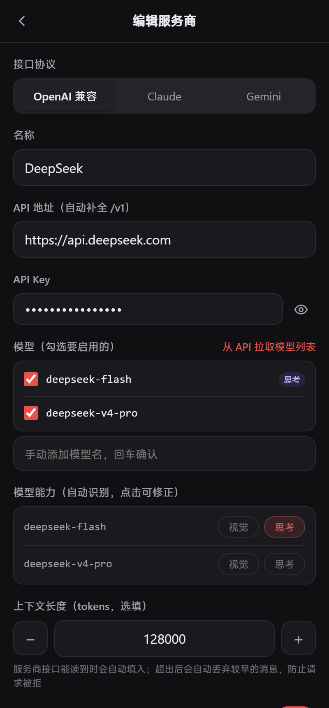
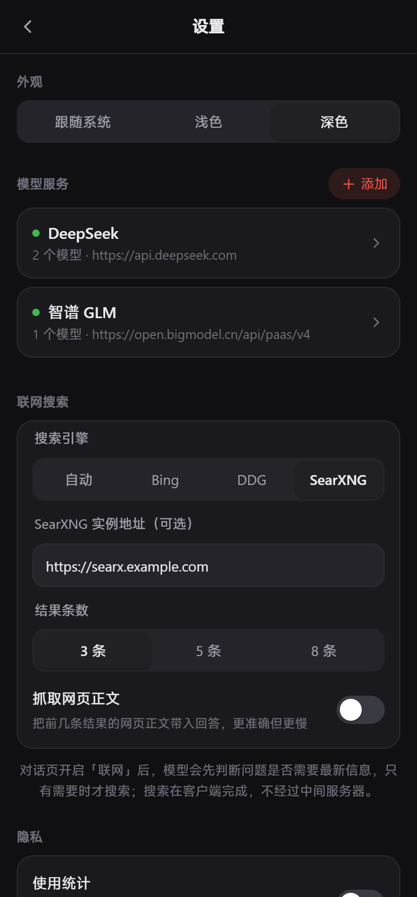

<div align="center">


# MoFa

**A mobile-first LLM chat client for Android.**

[English](./README.md) | [简体中文](./README.zh-CN.md)

Android APK & PWA · Bring your own API key · 100% local data

<p>
  
  
  
</p>

</div>

MoFa is an open-source AI chat app for Android. Connect your own API keys (OpenAI-compatible, Claude, Gemini, DeepSeek, SiliconFlow, OpenRouter, Ollama…) and chat with streaming responses, markdown, code highlighting, image input and reasoning models. All conversations and keys stay on your device.

<div align="center">
  
</div>

<div align="center">
  
  
  
</div>

## Features

- **Multi-provider** — OpenAI-compatible APIs, Claude (Anthropic) and Gemini native protocols; per-provider API key & base URL
- **Streaming chat** — real-time token streaming with markdown rendering and code syntax highlighting
- **Thinking mode** — show model reasoning (DeepSeek-R1, QwQ…), adjustable thinking effort (low / medium / high)
- **Image input** — send photos to vision models, auto-compressed
- **Per-chat model** — each conversation remembers its own provider & model
- **Web search** — optional free web search (Bing / DuckDuckGo / SearXNG, no API key, scraped client-side); the model decides whether a search is needed, formulates the query and cites numbered sources
- **File I/O** — attach documents (PDF / Word / text / code, extracted client-side) and save replies as real files (.md / .txt / .json / .docx, share or download)
- **Context management** — auto-truncate history by rounds or token budget, with a model-window safety net
- **Assistant presets** — per-conversation system prompt with built-in presets
- **Sessions** — local history, rename, export to Markdown
- **Auto update** — in-app download with progress; install permission is requested once, then the update resumes automatically and the downloaded APK is cleaned up

## Download

- **Android 6.0+**: [Download MoFa v0.0.7 APK](https://yunsmart.cn/share/MoFa/mofa-0.0.7.apk)
- **iOS / any browser**: PWA — deploy `dist/` to any static server, then "Add to Home Screen" in Safari

## Development

```bash
npm install
npm run dev        # dev server, reachable from phones on the same Wi-Fi
npm run mock       # local mock LLM server (OpenAI / Anthropic / Gemini)
npm run build      # production build to dist/
npm run typecheck
```

## Testing

```bash
npm run test:smoke   # build + 16 regression checks against a local mock LLM (~60s)
```

See [docs/TESTING.md](docs/TESTING.md) for the full checklist (manual + native Android) and the rules every change must follow.

Build the Android APK (requires Android Studio):

```bash
npm run release 0.0.7 "release notes"
# → releases/mofa-0.0.7.apk + releases/latest.json (for in-app updates)
```

## Tech Stack

Vue 3 · TypeScript · Vite · Pinia · Dexie (IndexedDB) · Capacitor 7 · markdown-it + highlight.js

## Project Structure

```
src/
├── components/       # UI (chat/, ui/)
├── composables/      # useToast / useDialog / useUpdate / useBackHandler
├── db/               # Dexie: conversations & messages
├── lib/              # markdown pipeline, image compression, model abilities
├── services/
│   ├── llm/          # protocol adapters: openai-compatible / anthropic / gemini
│   ├── update.ts     # in-app update
│   └── stats.ts      # anonymous usage stats (opt-out in settings)
├── stores/           # Pinia: settings / providers / chat
└── views/            # ChatView / SettingsView / ProviderEditView
```

## License

[MIT](./LICENSE)
